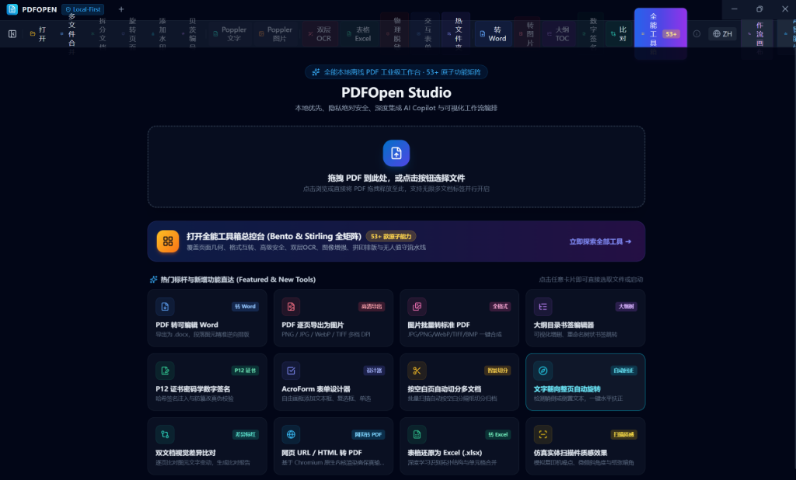
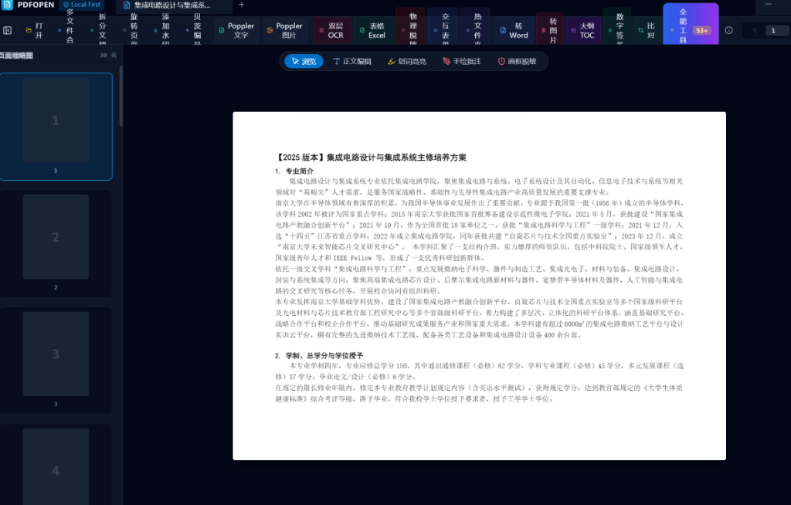
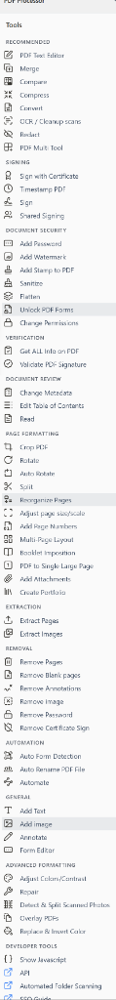

<div align="center">

# 📄 LibrePDF Studio

**The Local-First, AI-Native, All-in-One PDF Powerhouse for Global Users**

[](https://github.com/PDFCraftTool/LibrePDF/releases)
[](https://opensource.org/licenses/Apache-2.0)
[]()
[](http://makeapullrequest.com)
[]()
[]()
[]()

<p align="center">
  <strong>100% Privacy-Preserving • 53+ Comprehensive Atomic Tools • Offline AI Copilot • Visual DAG Workflow Studio • In-Place Editing</strong>
</p>

---

</div>

<p align="center">
  
</p>

## 💡 Why LibrePDF Studio?

Most online and commercial PDF software suffer from severe limitations: **intrusive data privacy uploads, expensive recurring subscription models, cluttered interfaces, or slow rendering**. 

**LibrePDF Studio** is designed from the ground up as a modern, unified, clean-room desktop application. It merges the complete feature capabilities of international tools like **Stirling-PDF** and **BentoPDF** into a sleek, native desktop experience powered by **React 19 + Electron + Vite**, with zero external cloud dependencies.

---

## 📸 Interface Preview & Visual Showcase

### 1. Modern Workspace with Real Thumbnail Navigation & In-Place Editing
> High-performance hardware-accelerated viewport, real rasterized page thumbnails, inline text editing, and persistent pen & highlighter overlays.

<p align="center">
  
</p>

### 2. 53+ Enterprise-Grade Atomic Tool Matrix
> Comprehensive utility cockpit providing instant access to all PDF operations with zero configuration.

<p align="center">
  
</p>

### 3. Visual DAG Workflow Studio (Node-Based Pipelines)
> Chain multiple operations together with an intuitive ComfyUI-like node graph (e.g., Deskew → OCR Sandwich → Redact → Compress → Watermark).

<p align="center">
  
</p>

---

## 🌟 Core Highlights & Architectural Features

### 🛡️ 100% Local-First & Zero Telemetry
- All processing occurs directly on your physical machine. 
- Files never touch any remote server, fulfilling strict compliance requirements (HIPAA, GDPR, enterprise financial regulations).

### 🤖 Offline AI Copilot & ReAct Intelligent Agent
- **Native Ollama / LM Studio Integration**: Connect directly to locally hosted open-weight models (Llama 3, Qwen 2.5, DeepSeek-R1, Mistral).
- **Natural Language Execution**: Tell the AI *"Rotate pages 3-5 by 90°, add a confidential watermark, and compress the file"*, and the agent automatically parses, plans, and queues the operations.
- **Privacy Audit Card**: Every AI-planned mutation requires explicit user authorization before execution.

### 📝 True In-Place Text Editing & Direct Canvas Preview
- **Instant Client-Side Text Extraction**: Click any text block on the canvas to modify font, text, or positioning directly.
- **Immediate In-Place Results**: Operations update directly in the center viewport canvas with real-time feedback—no annoying save dialogs interrupting your workflow.
- **Smart Staging**: Edit and preview freely, and hit `Ctrl+S` when you're satisfied.

---

## 🧰 Full Feature Matrix (53+ Capabilities)

<details open>
<summary><b>1. Page Organization & Geometry (13 Features)</b></summary>

| Capability | Description |
| :--- | :--- |
| **Merge PDFs** | Combine multiple documents in custom sequential order. |
| **Smart Split** | Split by single pages, custom page ranges (e.g., `1-3, 5, 8-12`), or fixed file sizes. |
| **Split by Blank Pages** | Automatically detect pure blank pages across large scan jobs to separate independent files. |
| **Split by Barcode / QR** | Identify barcodes/QR codes in batch scans and split automatically. |
| **Split by Bookmarks** | Split documents automatically based on internal outline/chapter bookmarks. |
| **Page Reordering** | Visual grid canvas to drag, drop, reorder, and reorganize pages. |
| **Permanent Rotation** | Rotate specific pages or entire documents by 90°, 180°, or 270°. |
| **Extract Pages** | Extract selected page ranges and save as a new independent PDF. |
| **Delete Pages** | Batch discard unnecessary or corrupt pages. |
| **N-Up Multi-Page Imposition** | Impose 2, 4, 9, or 16 pages onto a single sheet. |
| **Posterize / Tile** | Split a single large page into multi-sheet printable tiles (e.g., 2x2 grid). |
| **Booklet Layout** | Re-sequence pages for two-sided saddle-stitch booklet printing. |
| **Scale Page Canvas** | Uniformly scale pages to standard dimensions (A4, A3, Letter, Legal). |
| **Crop & Add Margins** | Crop black scan borders or expand white margins for binding holes. |

</details>

<details open>
<summary><b>2. Format Conversions: Convert TO & FROM PDF (12 Features)</b></summary>

| Capability | Description |
| :--- | :--- |
| **Images to PDF** | Batch convert JPG, PNG, WebP, TIFF, GIF, BMP into standard PDFs. |
| **PDF to High-Fidelity Images** | Export pages as crisp PNG, JPG, WebP, or TIFF at configurable DPI. |
| **PDF to Word (.docx)** | Reverse layout reconstruction into fully editable Microsoft Word documents. |
| **PDF to Presentation (.pptx)** | Render pages into native slide presentations. |
| **Office Documents to PDF** | Convert Word (.doc, .docx), Excel (.xlsx), PowerPoint (.pptx) to PDF. |
| **Webpage & HTML to PDF** | Render live URLs or uploaded HTML/CSS files into PDF format. |
| **Markdown & Text to PDF** | Compile Markdown (.md) or raw text (.txt) into cleanly formatted PDFs. |
| **Comic Books to PDF** | Unpack and assemble CBZ / CBR comic archives into PDF. |
| **Physical Layout Text Extraction** | Poppler-native multi-column preserved raw text extraction (`pdftotext -layout`). |
| **Lossless Image Extraction** | Extract embedded images directly from the raw PDF binary stream without re-sampling. |
| **Attachment Management** | Embed external files into the PDF container or extract bundled attachments. |
| **PDF to Standalone HTML** | Convert documents into standalone HTML web pages. |

</details>

<details open>
<summary><b>3. Security, Privacy & Legal Compliance (7 Features)</b></summary>

| Capability | Description |
| :--- | :--- |
| **P12 Digital Cryptographic Signatures** | Sign and verify PDFs using industry-standard P12/PFX certificates and timestamp authorities (TSA). |
| **True Physical Redaction** | Irreversibly burn out sensitive keywords or rectangular drawn regions at the binary level. |
| **Encryption & Permission Locking** | Set user and owner passwords; restrict printing, copying, and form modification. |
| **Decryption & Password Removal** | Strip passwords and restrictions to produce clean, unrestricted documents. |
| **Anti-Counterfeit Watermarks** | Stamp tiled, centered, or header/footer text & image watermarks with angle and opacity tuning. |
| **Legal Bates Numbering** | Sequentially stamp litigation case numbers and prefixes (e.g., `CONF-000001`). |
| **Metadata Sanitization** | Erase author, creation tool, revision history, and hidden XMP/XML tags. |

</details>

<details open>
<summary><b>4. Enhancement, Effects & AI Intelligence (11 Features)</b></summary>

| Capability | Description |
| :--- | :--- |
| **RapidOCR Sandwich PDF** | Generate 100% visually original, fully searchable and selectable dual-layer PDFs via ONNX. |
| **Deep Learning Table Extraction** | Recognize complex multi-cell tables and export cleanly formatted Excel (.xlsx) or CSV files. |
| **Two-Document Visual Comparison** | Side-by-side visual diff analysis highlighting modified and shifted elements in red. |
| **Realistic Scanner Effect** | Add photocopier noise, micro-skew, grain, and sepia paper texture to simulate real scans. |
| **Auto-Deskew** | Automatically detect skewed scan angles and straighten pages horizontally. |
| **Auto-Remove Blank Pages** | Remove purely blank pages based on pixel brightness and variance thresholds. |
| **Grayscale & Dark Mode Invert** | Convert to monochrome grayscale to save ink, or invert contrast for night reading. |
| **Repair & Reconstruct PDF** | Rebuild corrupt cross-reference (XRef) tables and non-standard stream structures. |
| **Compress & Optimize** | Downsample heavy images and optimize font streams to reduce file size. |
| **PDF/A Archival Conversion** | Convert documents to ISO 19005 compliant standards (PDF/A-1b) for long-term archiving. |
| **Interactive AcroForms** | Fill, recognize, extract, and flatten interactive form fields into static vectors. |

</details>

<details open>
<summary><b>5. Automation & Enterprise Productivity (10 Features)</b></summary>

| Capability | Description |
| :--- | :--- |
| **Visual DAG Workflow Studio** | Drag-and-drop node graph canvas for complex multi-step automated batch pipelines. |
| **Hot Folder Daemon** | Watch local directories to automatically process incoming files through assigned workflows. |
| **Interactive Outline / TOC Editor** | Visually add, rename, indent, and restructure hierarchical bookmark trees. |
| **Interactive Form Designer** | Drag-and-drop text inputs, checkboxes, and radio fields directly onto pages. |
| **Header, Footer & Page Numbers** | Inject dynamic numbering formats (e.g., `Page {n} of {total}`) at any corner. |
| **Continuous Single Page Stitching** | Stitch all sequential pages into one continuous vertical receipt/strip. |
| **Remove Annotations / Inks** | Strip comments, highlights, drawings, and popup markups with a single click. |
| **Auto-Rename via Intelligence** | Automatically suggest standardized file names based on title and document content. |
| **Multi-Tab Document Workspace** | Work with multiple files concurrently in a clean browser-style tab interface. |
| **Local Keychain Management** | Securely store and encrypt AI endpoints, API keys, and certificate credentials. |

</details>

---

## 🚀 Quick Start & Installation

### Option 1: Download Pre-built Binaries (Recommended)
Download the latest pre-compiled releases from our [**GitHub Releases**](https://github.com/your-username/librepdf/releases) page:

- **Windows**:
  - `LibrePDF Studio-x.x.x-win-x64.exe` (Portable Single-File, double-click to run)
  - `LibrePDF Studio Setup-x.x.x.exe` (Standard NSIS Installer)
- **macOS**:
  - `LibrePDF Studio-x.x.x-mac-universal.dmg` (Apple Silicon & Intel)
  - `LibrePDF Studio-x.x.x-mac.zip`
- **Linux**:
  - `LibrePDF Studio-x.x.x-linux-x86_64.AppImage` (Universal Executable)
  - `LibrePDF Studio-x.x.x-linux-amd64.deb` (Debian / Ubuntu)

---

### Option 2: Build from Source

#### Prerequisites
- **Node.js** >= 20.0
- **pnpm** >= 9.0 (or npm)
- *(Optional)* Python 3.10+ (for advanced OCR and table extraction sidecars)

#### Installation & Development
```bash
# 1. Clone repository
git clone https://github.com/PDFCraftTool/LibrePDF.git
cd LibrePDF

# 2. Install dependencies
pnpm install

# 3. Start local development server
pnpm dev

# 4. Run automated Clean-Room test suite
pnpm test
```

#### Package for Production
```bash
# Package for current OS
pnpm electron:build

# Or build platform-specific packages:
pnpm electron:build:win    # Windows (.exe & portable)
pnpm electron:build:mac    # macOS (.dmg & .zip)
pnpm electron:build:linux  # Linux (.AppImage & .deb)
```

---

## 🏛️ Project Architecture

```
librepdf/
├── .github/
│   └── workflows/
│       ├── ci.yml            # Automated typecheck & 37 clean-room tests on PR
│       └── release.yml       # Multi-OS matrix build & automatic release asset deployment
├── src/
│   ├── main/                 # Electron Main Process
│   │   ├── index.ts          # Window lifecycle & Typed IPC registration
│   │   └── services/         # PDFService, PopplerService, AIService, PythonService
│   ├── preload/              # Preload Scripts
│   │   └── index.ts          # contextBridge safe IPC APIs
│   ├── renderer/             # React 19 Frontend
│   │   └── src/
│   │       ├── components/
│   │       │   ├── layout/   # TitleBar, ToolBar (Dropdown groups & in-place save)
│   │       │   ├── viewer/   # PDFViewer (PDF.js canvas, in-place edit & thumbnails)
│   │       │   ├── copilot/  # AI Copilot drawer & privacy cards
│   │       │   ├── workflow/ # React Flow node-based workflow canvas
│   │       │   └── dialogs/  # All 25+ modal dialog interfaces
│   │       ├── stores/       # Zustand central state management
│   │       └── i18n/         # Internationalization dictionary (en-US, zh-CN)
│   └── shared/               # Cross-process TypeScript contracts
├── python/                   # Python Intelligence Sidecar (RapidOCR, Layout, PyMuPDF)
├── resources/                # Static assets, fonts, and binaries
├── tests/                    # 37 Clean-Room automated verification test suites
└── electron-builder.json5    # Multi-platform packaging configuration
```

---

## 🛡️ Clean-Room Implementation & Compliance Assurance

LibrePDF Studio is built with **100% Clean-Room Independent Engineering**:
- **Zero GPL/AGPL Source Pollution**: All features are implemented independently using MIT/Apache 2.0 compatible libraries (`pdf-lib`, `PDF.js`, `React 19`, `OpenPyXL`, `RapidOCR-ONNX`, `pyHanko`).
- **Commercial Friendly**: No proprietary lock-in. Suitable for enterprise internal adoption, redistribution, and customization.

---

## 🤝 Contributing

Contributions are warmly welcomed! Please feel free to submit issues, feature requests, or Pull Requests:

1. Fork the Repository
2. Create your Feature Branch (`git checkout -b feature/AmazingFeature`)
3. Commit your Changes (`git commit -m 'Add some AmazingFeature'`)
4. Push to the Branch (`git push origin feature/AmazingFeature`)
5. Open a Pull Request

---

## 📄 License

This project is licensed under the **Apache License 2.0** - see the [LICENSE](LICENSE) file for details.

```
Copyright 2026 LibrePDF Studio Authors

Licensed under the Apache License, Version 2.0 (the "License");
you may not use this file except in compliance with the License.
You may obtain a copy of the License at

    http://www.apache.org/licenses/LICENSE-2.0
```

---

<div align="center">
  <sub>Built with ❤️ by the LibrePDF Open Source Community. Star ⭐ this repository if you find it helpful!</sub>
</div>
